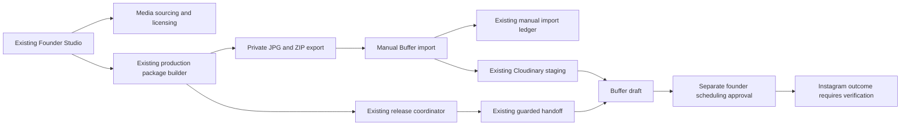

# Live architecture and inventory

Observed October 28, 2026, approximately 7:37 PM America/New_York. Generated from the successful read-only production audit. Existing n8n workflows and tables remain authoritative; no new publishing backend was deployed.

The manual, guarded and coordinator paths must share an authoritative claim boundary before concurrency safety can be claimed. The local SQLite ledger is a reference implementation, not a deployed authority.

## Workflow inventory

| Workflow | ID | Active | Saved differs from active |
| --- | --- | --- | --- |
| MILDINCIDENT · Cloudinary Sample Upload Smoke Test | `5IGWZXc7nLufItgn` | no | no |
| 02 — Editorial Research / Idea Intake | `75BYc3JkTnA2eQVc` | yes | yes |
| 04 — Founder / Concept Approval | `77xnMJZ4bzo4VCVX` | yes | no |
| 09 — Analytics / Weekly Learning Report | `92oYJ5EcJnaY22QP` | no | no |
| MILDINCIDENT · Manual Unscheduled Buffer Draft Import | `BzMqQS8lfkwN7peQ` | yes | no |
| MILDINCIDENT · Buffer Test Draft Sandbox | `EG3DpXQnAEQvuXGN` | no | no |
| TEMP — Sprint1 Research Failure Simulation | `GysJYqXPJapD9WlA` | no | no |
| MILDINCIDENT · Buffer Connector (Read-Only) | `IlxRWqHGIetMZR2U` | no | no |
| TEMP — Dashboard Access Security Probe | `Kvdc0TugApGnjwvr` | no | no |
| MILDINCIDENT · Inline Image Use Review | `MbloXbJ1bb0UhmH6` | yes | no |
| TEMP — mildincident Film Concept Chief AI Diagnostic | `PEe60iDcTulpRKKm` | no | no |
| MILDINCIDENT · Buffer Draft or Queue Handoff (Guarded) | `Q02tRHMtZ90Kib18` | yes | no |
| 09 — Export Ordered Draft Carousel Package | `SoTFBz46LCWVp5EO` | yes | yes |
| 08 — Private Editorial Draft JPEG Proof | `TGEsRjBElu8epzLU` | yes | no |
| 04B — Concept Dossier / Review Page | `TP0AlwZxJ58rkDCv` | yes | no |
| MILDINCIDENT · Cloudinary Connection Test | `XMjaQvJb9OS1rTSf` | no | no |
| 06 — Editorial Production / Package Builder & Proofs | `YdW8V9Qxl2qn5mC8` | yes | no |
| 05 — Media / Sourcing & Licensing | `Zouc5I3MQwRJhfXG` | yes | yes |
| 03 — Chief AI / Quality Gate | `bc6s9K5aMPNPzsPU` | no | no |
| 00 — Founder Command Center / Private Dashboard | `ecWr4PeKU4vKLQ1m` | yes | no |
| MILDINCIDENT · Approved Production Cloudinary Staging | `f0LkxPxzvqh3zyUQ` | yes | no |
| 11 — Canva Photo Finish / Secure Return Upload | `oIvCdbki1qyPtkYW` | yes | no |
| 08 — Publishing Preflight / No Auto-Post | `rgXDAUak4k46q9jG` | yes | no |
| 07 — Founder Final Post Approval | `rhZU4CyF5t0kYMzz` | yes | no |
| 10 — Inspect Original Source Image Quality | `sZVmWBHkg6supxRz` | yes | no |
| MILDINCIDENT · Finalize & Send / Founder Release Coordinator | `v5ThKs5ZYP3RhZop` | yes | no |
| 01 — Brand Brain / Seed & Update | `zRVzADJUC6MOm9bH` | yes | no |

## Tables

| Table | ID | Rows | Columns |
| --- | --- | ---: | ---: |
| MILDINCIDENT · Manual Buffer Draft Imports | `qQgPtQvq3V0hyZia` | 9 | 9 |
| export_packages | `dbyxu6uxL2Tpiaxd` | 62 | 15 |
| MILDINCIDENT · Private Clean Preview Archive | `Mf1GWRTseSOioyV6` | 11 | 15 |
| production_packages | `cCFwaHyKVVTZvr5s` | 11 | 48 |
| experiment_decision_log | `jfIlv4bFRpyUGqF6` | 71 | 11 |
| media_library | `ARiuqg92GgVSpZMr` | 264 | 28 |
| media_search_history | `RQAar3mEXc5dx7Px` | 44 | 11 |
| content_pipeline | `5AxSMHqi15TNwBZl` | 18 | 25 |
| research_library | `cbfqgjpt5gR4Ss2P` | 59 | 12 |
| editorial_seed_selection | `OQUJtdxjKZQLhYwS` | 1 | 4 |
| MILDINCIDENT · Story Lifecycle Archive | `xxm1mdsO2pukqQjE` | 3 | 7 |
| MILDINCIDENT · Story Sound Direction | `BB5JIwLWNs13m2Tv` | 3 | 6 |
| MILDINCIDENT · Editorial Soundtrack Catalog | `UogVP7r92OOTCXd8` | 40 | 8 |
| MILDINCIDENT · Curated Editorial Image Archives | `0Jx83xL1evH0R8l2` | 20 | 11 |
| MILDINCIDENT · Blocked Photo Source Hosts | `tfaQkg52vo0AMvJQ` | 20 | 3 |
| MILDINCIDENT · Cloudinary Delivery Settings | `878rNoumzhbNVueu` | 1 | 4 |
| MILDINCIDENT · Buffer Public Media Staging | `lLXVATP5mOBIoogV` | 0 | 9 |
| MILDINCIDENT · Buffer Draft Handoff Log | `lBncgD93WV9a8oMu` | 0 | 10 |
| editorial_brain_snapshots | `7jF9Bc5YIdj1qGyE` | 1 | 8 |
| production_render_proofs | `NEO7s23dFiIdUb1u` | 6 | 13 |
| editorial_idea_bank | `wDjKUNWQ2J8LJQfK` | 8 | 10 |
| editorial_seed_presets | `2NoRbvxCc120cM8t` | 4 | 8 |
| photo_finishing_variants | `KD4yz0APn5MitGWX` | 0 | 24 |
| final_review_log | `Jiows2tODEIIOFa3` | 0 | 7 |
| production_storage_config | `SadlgxsgEy8crcFO` | 1 | 13 |
| video_source_library | `6Fy14wxazNsHlObR` | 4 | 26 |
| production_file_registry | `HOjGxJlmAiJZHYsR` | 0 | 30 |
| editorial_archive_pre_sprint2_20261019 | `Z5vxAGtf7eh7daZX` | 64 | 6 |
| brand_brain | `cmYKhFTfNBT204bE` | 54 | 6 |
| performance_log | `UQiRdrpUdp5czWRy` | 0 | 15 |

## Explicit subworkflow dependencies

These are active-graph Execute Workflow node references, not inferred from workflow titles. Inline webhook/HTTP/UI links can add dependencies and are not fully represented here.

- `77xnMJZ4bzo4VCVX` → `Zouc5I3MQwRJhfXG`
- `Zouc5I3MQwRJhfXG` → `Zouc5I3MQwRJhfXG`
- `bc6s9K5aMPNPzsPU` → `77xnMJZ4bzo4VCVX`
- `v5ThKs5ZYP3RhZop` → `f0LkxPxzvqh3zyUQ`, `Q02tRHMtZ90Kib18`, `YdW8V9Qxl2qn5mC8`, `rhZU4CyF5t0kYMzz`

Actual table column names, active/saved graph snapshots, execution summaries and row snapshots are retained privately under `.local/audits/production-*`. See LIVE_AUDIT.md for scope limits and PRODUCTION_REVIEW.md for version-bound changes and rollback.
