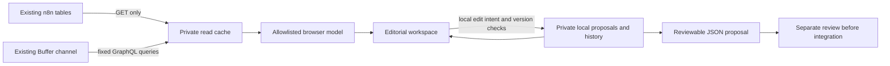

# Product-wide editorial workspace

This sprint adds a functioning local frontend over the **existing n8n and Buffer system**. It is not a new publishing backend and has not replaced the production Founder Studio. Production writes, deployment, scheduling and publication remain disabled.

## Run and verify

```sh
cd /workspace/Mildincident
npm ci
npm run workspace
```

The application listens on loopback port **4174**. It uses the existing secure API bindings, inherited HTTPS proxy and CA trust. The source starts from the last complete private cache, then refreshes fixed read-only n8n table routes and Buffer queries. It does not require new API tokens. `PORT` can select another local port.

```sh
npm run check
npm test
npm run test:browser
```

Browser tests use pinned Playwright with the environment's installed `/usr/bin/chromium`, or `CHROMIUM_PATH`. They require local loopback/child-process permission in a restricted sandbox. They do not disable TLS verification, access production assets or create live posts. Test drafts and labeled synthetic image fixtures live in a temporary private store and are removed afterward. The `studio` command remains the old historical launch brief on 4173; `workspace` is the new product-wide development UI.

## Implemented vertical slices

| Slice | What works | Data / persistence | Validation |
| --- | --- | --- | --- |
| Editorial desk and pipeline | Actual preparation/reconciliation counts, story spotlight, next actions, title/subject/ID search, stage filters and keyboard navigation | Read-only source snapshot | Browser navigation/search/empty states; actual 18-story smoke |
| Unified story desk | Research claims, original-source links, existing founder/production/source-review notes, local working notes, caption and music under one ID | Actual n8n records; notes/caption proposals stay local | Sanitization/revision tests; actual source-note render |
| Image review and carousel | 264 actual candidate records, rights filters, provenance dialogs, side-by-side comparison, add/remove/reorder with drag and keyboard-accessible controls | Source metadata and direct browser previews; local sequence overlay | Browser comparison/reordering; foreign/duplicate asset rejection |
| Private editorial editing | Debounced versioned autosave, restart persistence, save/retry errors, reviewed stale-source rebase, version history/restore and proposal download | Ignored SQLite; no n8n write adapter | Conflict/restart/rebase/removed-image and streaming-body race tests; browser reload/recovery |
| Publishing and archive | Manual lifecycle vs Buffer observation vs independently verified Instagram state, mapped IDs, reported links, duplicate/reconciliation flags and all unmapped provider rows | Read-only provider scan, no automatic identity inference | Projection tests; four actual unmapped records visible |
| Editorial intelligence | Source deduplication, caption lint, duplicate-story candidates, selected-photo-metadata soundtrack ranking with saved preferences retained | Actual text/catalog metadata; no external verification, pixels or audio | Dedicated sparse/negative/Unicode/identity tests |
| Performance | Measured metric totals/rates with sample sizes, missing measurements, New York publishing buckets, production bottlenecks and coverage | Actual Buffer observations where available; empty performance log is not fabricated | Metric/unit/null/zero/duplicate/internal-test tests; actual four measured editorial sends |

No fake send, schedule, publish, rights-clearance or production-save buttons are present. Proposal download is enabled only after a local edit exists, with a separately labeled rescue download if a browser edit has not reached the local server.

## Data flow and contracts



`src/workspace/contracts.d.ts` describes the browser/local-edit contract. `model.js` explicitly selects fields; raw workflow/table rows, API credentials, founder review tokens and final-review tokens never go to the browser. Raw snapshots stay in ignored `.local/`. URLs with embedded authentication/signing parameters are withheld. No image URL is downloaded server-side.

The source refresh must complete the fixed table scans and provider pagination before replacing the cache. A failed refresh keeps the prior snapshot and exposes a controlled error, never a success message. Refreshes coalesce; synchronous loader failures remain retryable. Metrics failures do not turn missing observations into zero. Cache timestamps and a 15-minute stale indicator are visible; this is not a real-time subscription to n8n edits.

## Local editing and conflict recovery

Every saved local draft has its existing story ID, source revision, local version and save time. The source digest includes decision-relevant caption, format, approval, target count, claims, notes, selections and media provenance. An unrelated Buffer-status refresh does not invalidate caption work.

- The backend rechecks the current source after reading a save body, preventing an in-flight refresh from admitting a stale edit.
- SQLite transactions prevent tabs from overwriting the same local version.
- Source refresh flushes pending browser saves first. Pending/in-flight work retains its original base revision; it is never silently retagged to newer content.
- A source mismatch pauses editing and shows source/local comparison. Keeping local edits requires explicit confirmation and creates another local version. Removed source images require an explicitly reviewed replacement sequence; the prior selection remains in history.
- Local history is retained. Restoring an earlier version makes a new save rather than deleting later versions.
- Captions, notes, selected images and music can be proposed. Rights, live stage, scheduling and publication fields cannot be changed through this API.
- Proposal JSON marks `productionApplied`, `publicationApproved` and `rightsGranted` false. An unsaved browser rescue is separately labeled and is not a saved server version.

## Local API surface

| Route | Behavior |
| --- | --- |
| `GET /api/health` | Local mode, source availability and refresh status |
| `GET /api/workspace` | Sanitized source/model and local overlays |
| `GET /api/stories/:id` | One existing story |
| `PATCH /api/stories/:id/draft` | Local-only save with `baseRevision` and `expectedVersion` |
| `GET /api/stories/:id/draft/history` | Local editorial versions |
| `POST /api/stories/:id/draft/rebase` | Explicit reviewed local rebase; optional reviewed replacement IDs |
| `GET /api/stories/:id/proposal` | Download a saved local change proposal |
| `POST /api/refresh` | Start read-only source refresh; changes only local cache |

Local edit/refresh operations require `X-Mildincident-Intent: local-edit`; edit bodies require JSON and are bounded. The listener is loopback-only, Host/Origin checked, with no CORS or general proxy endpoint. Static paths use realpath containment, preventing symlink escapes. Browser scripts/styles are local modules under a restrictive CSP. No generic GraphQL executor or arbitrary n8n action route is exposed.

## Observation and interpretation limits

At the extended sprint's refresh, the workspace contained **18 stories, 264 media candidates and 11 Buffer records**. Four of nine eligible editorial sends had usable performance observations. The marked internal test stays visible in publishing history but is excluded from audience-performance aggregation. Suspected duplicate posts are not deleted or automatically merged; metrics describe observed post records, not unique editorial stories.

Media previews could not be loaded in this cloud browser; source/provenance links and unavailable-preview states were checked. No archival imagery was synthesized to fill the gap. Preview availability should be tested from the intended authenticated staging browser/network before deployment.

Stored citations do not prove factual correctness. Catalog/public-domain labels do not grant per-image rights. Music suggestions do not prove Instagram availability or licensing. Buffer `sent` and reported links remain distinct from independently verified Instagram outcomes. There are no invented stage durations, causal performance claims or recommended posting times from this small sample.

## Production integration and rollback

Deployment approval is still required. Do not simply expose port 4174 or change the listener to a public interface. The current local-origin boundary is for development, not public authentication.

1. Review frontend behavior and data-field allowlists. Select an authenticated staging host/origin consistent with the existing Founder Studio or suitable Lovable project; Lovable tools/source are not available in this session.
2. Add and test founder authentication, authorization, session/CSRF protections and explicit proxy-origin handling for the chosen host. Preserve the credential boundary and existing routes. Test private preview delivery without an arbitrary downloader.
3. Keep n8n authoritative. Define a reviewed proposal-to-existing-package adapter with source revision checks, per-image permission gates and backup/rollback. There is no automatic proposal import today.
4. Finish the separate n8n atomic claim/credential integration checks in `ATOMIC_CLAIM_REVIEW.md` before any Buffer create path is enabled. Local SQL tests are not proof of the deployed engine.
5. Obtain approval for the exact frontend/workflow/schema changes, stage them, then verify active versions and read-back outcomes. None of those deployments happened in this sprint.

Local rollback: stop the workspace process and use the previous branch commit. Keep `.local/workspace/drafts.sqlite` (including WAL/checkpoint state), its history and review proposals; never remove it to fix a source conflict. The existing n8n/Buffer system remains untouched and usable.
