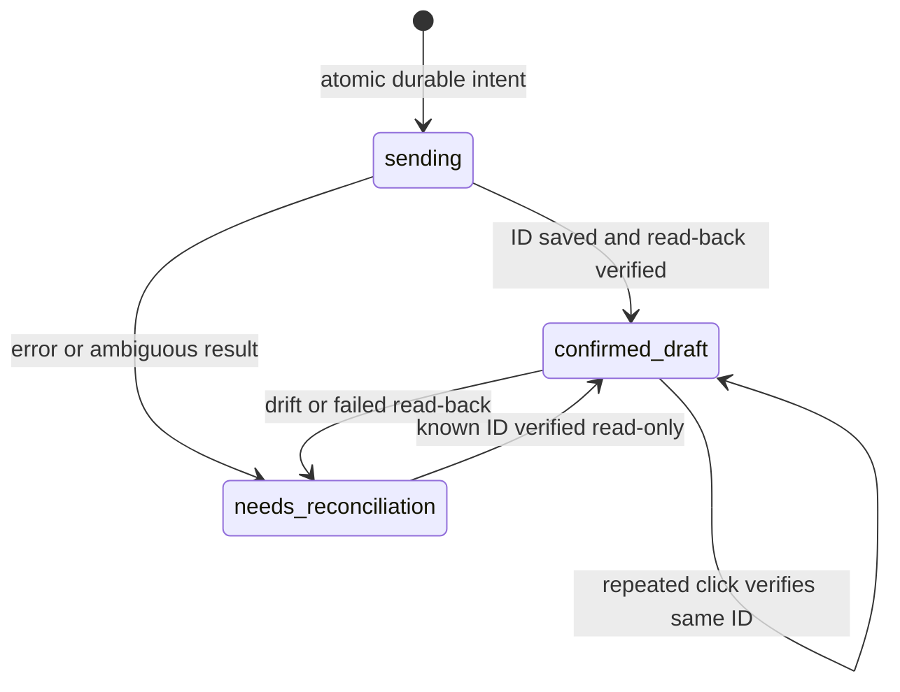

# Architecture and boundaries

Current production inventory and dependencies were verified in the subsequent sprint: see [live architecture](LIVE_ARCHITECTURE.md) and [live audit](LIVE_AUDIT.md). The diagram below preserves the initial historical context.

## Historical production architecture (not verified live)

Workflow and table IDs, historical version IDs, and existing story references are preserved in [the handoff](reference/handoff-2026-10-28.md). The n8n Code-node UI and early Lovable frontend are not present in the checkout. No production route has been redirected.

## Local implementation

| Module | Responsibility | External side effects |
| --- | --- | --- |
| `src/package.js` | Strict manifest validation; local asset boundary; full JPG decoding; metadata stripping; ordered immutable receipts | None; private local files only |
| `src/ledger.js` | SQLite WAL, synchronous FULL, unique story/channel claim, attempt state and append-only events | Private local SQLite state only |
| `src/handoff.js` | Current selection checks, rights gate, prior-handoff gate, one create attempt, verified read-back/reconciliation | Only through an injected adapter; no production adapter is supplied |
| `src/audit.js` | Fixed-destination GET-only n8n workflow/execution inspection | Read-only n8n requests after secure connection |
| `src/studio.js` / `public/studio.css` | Read-only editorial launch brief with historical references | None; loopback GET/HEAD only |
| `src/launch-brief.js` | Dated references to the four existing Halloween concepts | No story creation or import |

The private receipt binds current story/channel/version/revision, exact caption, original hashes, ordered cleaned hashes, source/creator records, and rights decisions. It is a consistency checksum, not a digital signature or proof of a legal license. Local image files are decoded to verify format and integrity, not analyzed for authenticity, visual taste, visible marks, or historical truth.

## Draft attempt state

Process death can leave `sending`; it is treated as uncertain and blocks resending. No timer, expiring lease, HTTP retry, process restart, caption edit, or package version increment resets the scope. Unknown remote IDs require a human/provider audit; caption similarity alone cannot identify a safe retry. There is no reset/delete/send-again command.

`confirmed_draft` means a draft-only read-back succeeded at a recorded time. It is distinct from manual story lifecycle statuses, current scheduling, and confirmed Instagram publication. Repeated handoff calls re-read the known ID. There is no automatic lifecycle update.

## Deployment boundary

SQLite only coordinates writers that share the same on-disk ledger. Separate cloud snapshots, lost files, restored backups, or another n8n workflow can create independent intents. A complete prior-handoff audit helps detect existing items but cannot by itself eliminate a race between separate writers. A **central, authoritative outbox/lock** or verified provider-native idempotency is required before live multi-client activation. The request key is sent to the adapter, but no claim is made that Buffer currently honors it.

Current-package checks happen before and after export. They cannot lock a live editor against subsequent concurrent edits; the production adapter must supply an authoritative revision/lease or equivalent conditional write boundary. Staging must rehash the actual upload bytes and preserve order. Credentials and original images never belong in Git.
